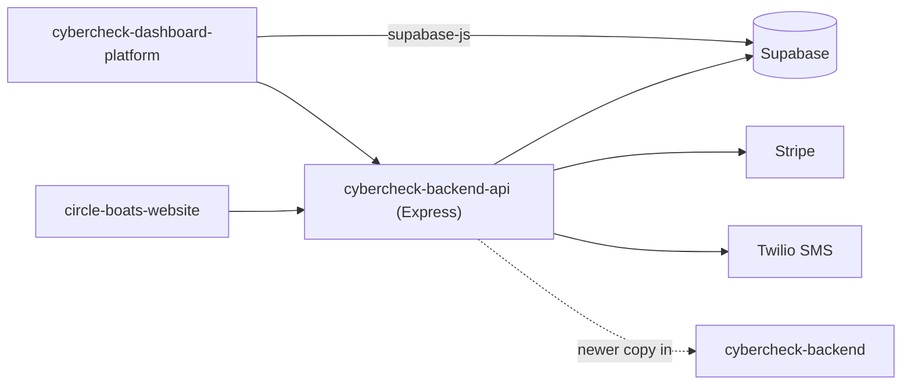

# cybercheck-dashboard

An older upload of the CyberCheck platform bundle (owner dashboard, API and boat-rental site); superseded by `cybercheck-backend`.

## What it is

Three folders that were uploaded together in February 2026: the business-owner dashboard web app, the API server
behind it, and the Beachside Circle Boats customer site. The same bundle now lives, in newer form, in
`cybercheck-backend`.

## How it works

- `cybercheck-dashboard-platform/`: vanilla-JS single-page app (`index.html`, `login.html`, `config.js`,
  `shared-data.js`, about 35 files in `js/` such as bookings, menu, staff, waivers, billing, site-editor and domain,
  plus `tabs/`). It signs in through Supabase (`js/supabase-client.js`) and talks to the API.
- `cybercheck-backend-api/`: Express app (`server.js`, package name `cybercheck-backend`). It mounts `/api/auth`,
  `/api/dashboard`, `/api/public` (behind a hostname-to-site resolver), `/api/admin`, `/api/gcr`, `/api/stripe`,
  `/api/analytics` and `/api/webhooks`. Routes are in `routes/`, Twilio SMS in `utils/sms.js`, data access in `db.js`.
  SQL: `schema.sql`, `schema-additions.sql`, `supabase/01` to `06`, run with `supabase/run-all-schemas.sh`.
- `circle-boats-website/`: the boat-rental customer site (`index.html`, backups, `links.html`, `tracking.js`, photos).
- Branches: `main` (2026-02-28, full bundle) and `master` (2026-03-02, only the dashboard-platform folder with a
  domain-settings addition).
- Compared with `cybercheck-backend` `main`, most files are identical; that repo adds `.env.example`, `vercel.json`,
  `07-fix-signup-rls.sql`, `tools/` and docs, and changes a few auth, server and dashboard files.

## Run it

```bash
cd cybercheck-backend-api
npm install
node server.js
```

Create a `.env` first (there is no `.env.example` in this copy). Names used by the code: `SUPABASE_URL`,
`SUPABASE_SERVICE_KEY`, `JWT_SECRET`, `PORT`, `NODE_ENV`, `CORS_ORIGINS`, `STRIPE_SECRET_KEY`,
`STRIPE_PUBLISHABLE_KEY`, `STRIPE_WEBHOOK_SECRET`, `STRIPE_CLIENT_ID`, `STRIPE_CONNECT_REDIRECT_URI`,
`PLATFORM_FEE_PERCENT`, `TWILIO_ACCOUNT_SID`, `TWILIO_AUTH_TOKEN`, `TWILIO_PHONE_NUMBER`.
A Supabase project with the SQL applied is also required. Not executed while writing this README.
Prefer the newer copy in `cybercheck-backend`.

## Status

Duplicate of `cybercheck-backend`: an older upload of the same bundle, superseded by the newer files there.

## Where it fits



## Related repos

- `cybercheck-backend`: the newer version of this same bundle; use that one.
- `cyber-admin`: its `dashboard/` folder is a newer variant of this dashboard.
